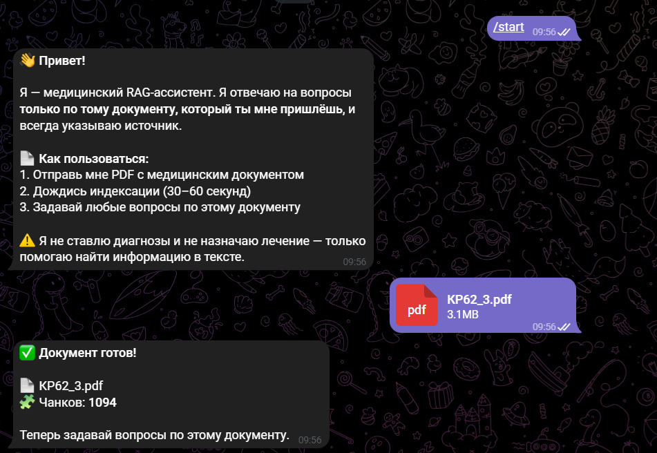
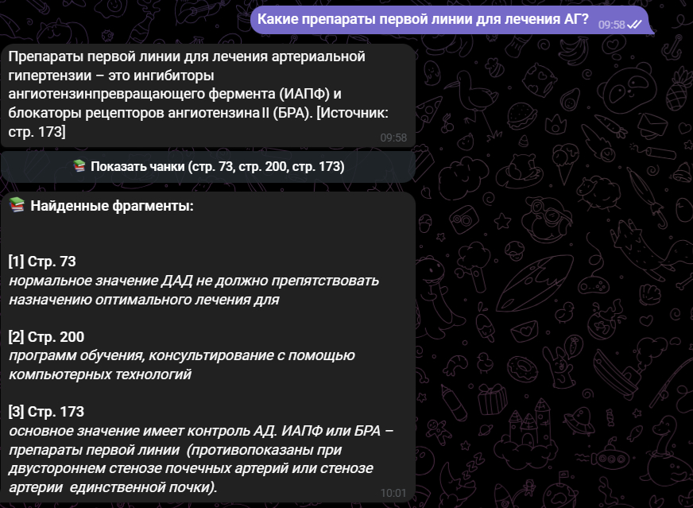
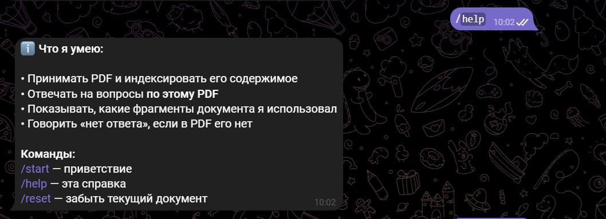
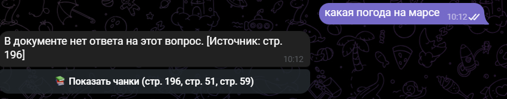

# 🩺 Medical RAG Assistant

Telegram-бот, который отвечает на вопросы по медицинским PDF-документам **только на основе загруженного текста**, с указанием источника. Спроектирован под кейс цифровой медицины: никаких галлюцинаций, всегда цитата, честное «не знаю».

> **Зачем:** в медицине цена ошибки LLM — здоровье человека. Модель не должна выдумывать. Этот бот — демонстрация RAG-подхода, где ответ строится строго по документу.

---

## 🎬 Демо

<table>
<tr>
<td width="50%">

### 1. Приветствие


### 2. Ответ с цитатой + кнопка «Показать чанки»


### 3. Источники: какие фрагменты использованы


</td>
<td width="50%">

### 4. Проверка на галлюцинации: вопрос вне документа


### 5. Сброс документа


</td>
</tr>
</table>

---

## 🧠 Как это работает

```
PDF → Загрузка → Чанкинг → Эмбеддинги → ChromaDB
                                              ↓
Вопрос → Эмбеддинг → MMR-retrieval (top-k) → Промпт → Groq LLM → Ответ + источник
```

**Ключевые этапы:**

1. **Загрузка** — `PyPDFLoader` разбивает PDF по страницам, сохраняя номер страницы в metadata
2. **Чанкинг** — `RecursiveCharacterTextSplitter` (chunk_size=500, overlap=50) — баланс между контекстом и точностью
3. **Эмбеддинги** — локальная модель `all-MiniLM-L6-v2` (384-мерные векторы, работает на CPU)
4. **Хранилище** — ChromaDB, persist на диск, защита от дублей при повторной индексации
5. **Retrieval** — MMR (Maximum Marginal Relevance): берём 10 кандидатов, выбираем 3 релевантных, но **не дублирующих** друг друга
6. **Генерация** — Groq LLM (`openai/gpt-oss-120b`), `temperature=0` для детерминизма, строгий system-промпт против галлюцинаций

---

## 🛠 Стек

| Категория | Технология |
|-----------|-----------|
| **Язык** | Python 3.11 |
| **Telegram** | aiogram 3.x |
| **LLM-фреймворк** | LangChain (LCEL) |
| **LLM-провайдер** | Groq (`openai/gpt-oss-120b`) |
| **Эмбеддинги** | HuggingFace `sentence-transformers/all-MiniLM-L6-v2` |
| **Векторная БД** | ChromaDB |
| **PDF** | pypdf |
| **Конфиг** | python-dotenv, pydantic |
| **Инфраструктура** | Docker, docker-compose |
| **Асинхронность** | asyncio + aiogram |

Стек **прямо релевантен** вакансиям Junior AI/Python в медицинских продуктах: RAG, LLM, эмбеддинги, векторные БД, работа с реальными PDF.

---

## 🚀 Быстрый старт

### 1. Клонировать и подготовить

```bash
git clone https://github.com/FlowerFool/Medical-rag-bot.git
cd Medical-rag-bot
python -m venv .venv
.venv\Scripts\activate      # Windows
# source .venv/bin/activate  # Linux/Mac
pip install -r requirements.txt
```

### 2. Получить ключи

- **Telegram Bot Token** — [@BotFather](https://t.me/BotFather) → `/newbot`
- **Groq API Key** — [console.groq.com](https://console.groq.com) → API Keys

### 3. Настроить `.env`

```bash
cp .env.example .env
```

Вставь свои ключи:
```env
TELEGRAM_BOT_TOKEN=твой_токен
GROQ_API_KEY=твой_ключ
GROQ_MODEL=openai/gpt-oss-120b
```

### 4. Запустить

```bash
python bot.py
```

Открой бота в Telegram → `/start` → отправь PDF → задавай вопросы.

---

## 🐳 Docker

```bash
docker compose up --build
```

Контейнер подхватит `.env` автоматически, `data/` и `chroma_db/` сохраняются на хосте через volumes.

---

## 🧪 Что я понял в процессе

Этот раздел — самое важное. Вот **реальные уроки**, которые я вынес:

### 1. Модели — не константа, а переменная

За время разработки **три модели подряд были деактивированы** у Groq: `llama-3.1-8b-instant`, `llama-3.3-70b-versatile` и др. Пришлось перейти на `openai/gpt-oss-120b`.

**Вывод:** в продакшене нужен fallback-механизм. Модель должна быть в конфиге (env), ошибки — логироваться, а не пробрасываться в UI.

### 2. Маленькие модели «тупят» на граничных вопросах

`llama-3.1-8b` на вопрос, ответа на который нет в контексте, иногда возвращала **пустую строку** вместо явного «нет ответа». Пришлось:
- Сменить модель на более крупную
- Добавить fallback в код: если LLM вернул пустоту — показать пользователю понятное сообщение

**Вывод:** граничные случаи — основная зона багов. Нужны тесты на «что если ответа нет».

### 3. Галлюцинации лечатся не только промптом

Строгий system-промпт («отвечай только по контексту, если нет — скажи не знаю») — **необходим, но не достаточен**. `temperature=0` + явная формулировка «не знаю» + тест с вопросом вне документа — всё вместе даёт стабильное поведение.

**Вывод:** борьба с галлюцинациями — это комбинация промпта, температуры и **тестирования**.

### 4. Дедупликация retrieval — обязательна

Первая версия возвращала 3 почти одинаковых чанка. Решил через **MMR** (`search_type="mmr"`, `fetch_k=10`, `lambda_mult=0.5`) — берём больше кандидатов, выбираем разнообразные.

**Вывод:** базовый top-k retrieval без MMR плохо работает в RAG. MMR — минимальный must-have.

### 5. Идемпотентность индексации

Первая версия при повторном запуске `test_rag.py` **дублировала** чанки в ChromaDB. Добавил `force_recreate=True` — старая коллекция удаляется перед индексацией.

**Вывод:** операции записи должны быть идемпотентны. Особенно в системах, где данные копятся.

---

## 📁 Структура проекта

```
medical-rag-bot/
├── bot.py                  # Точка входа Telegram-бота (aiogram)
├── bot_utils.py            # Форматирование ответов под Telegram
├── config.py               # Настройки из .env
├── test_rag.py             # Тест RAG-пайплайна
├── test_chain.py           # Тест генерации ответов
├── rag/
│   ├── loader.py           # Загрузка PDF
│   ├── chunking.py         # Разбивка на чанки
│   ├── embeddings.py       # Модель эмбеддингов
│   ├── vectorstore.py      # ChromaDB + защита от дублей
│   ├── chain.py            # RAG-цепочка + MMR retriever
│   └── session.py          # Сессии пользователей
├── prompts/
│   └── system.txt          # Строгий системный промпт
├── data/                   # PDF-документы
├── screenshots/            # Скрины для README
├── Dockerfile
├── docker-compose.yml
├── requirements.txt
└── .env.example
```

---

## 🔮 Что можно улучшить (следующие шаги)

- **Cross-encoder reranking** — после MMR прогнать топ-10 через cross-encoder для точности
- **Гибридный поиск** — BM25 + dense embeddings (лучше для терминов и аббревиатур)
- **Персистентные сессии** — Redis вместо in-memory словаря
- **Метрики качества** — golden dataset вопросов + автоматический прогон
- **Оценка faithfulness** — LLM-as-judge для проверки, что ответ не противоречит контексту

---

## 📝 Лицензия

MIT. Используй как хочешь.